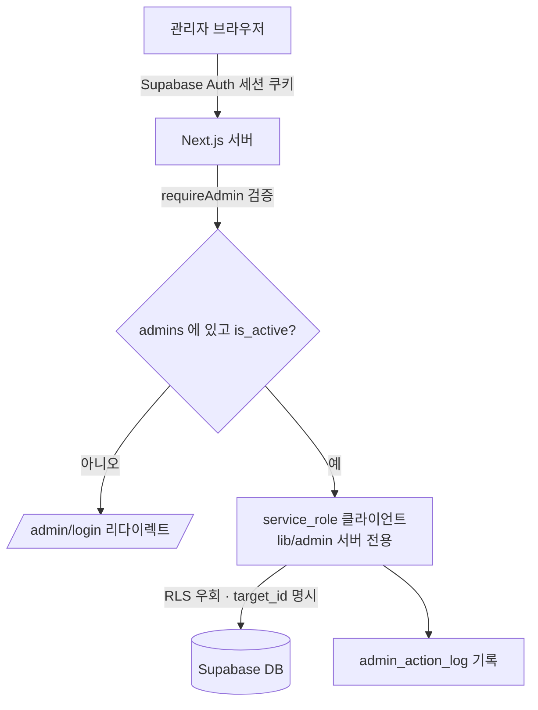

> **📌 구현 방향 변경 안내**: 아래 문서는 "대행(약국/손님을 대신 조작)" 모델로 설계됐지만,
> 실제 구현은 **관제 대시보드**(열람 + 정지·삭제·차단 같은 제한된 관리) 방향으로 바뀌었습니다.
> 아래 1~4·7·8절의 원칙(로그인 아님, `requireAdmin` 게이트, `service_role`은 서버 전용,
> 감사 로그)은 그대로 적용됩니다. 5·6절(약국/손님 대행 설계)은 더 이상 실제 구현과 다르며,
> 실제 화면·서버 액션 구성은 [README.md](../README.md)의 "관리자 패널" 절을 보세요.

# 팜들리 관리자 대행 기능 — DB · 보안 설계

> 대상 기능: **약국 포탈 대행**, **손님 포탈 대행**
> 전제: 관리자 = Supabase Auth + `admins` 테이블 / 약국 = 자체 `password_hash` 인증 / 손님 = Supabase Auth(`auth.users`), 예약과는 전화번호로 매칭 / 관리자 패널 = Next.js 서버에서 `service_role` 사용

---

## 1. 핵심 원칙 — "대행"은 로그인이 아니라 "대신 수행"

관리자는 약국이나 손님으로 **실제 로그인하지 않는다.** 대신 관리자 신원을 검증한 뒤, 대상(약국 id 또는 손님)을 **명시적으로 지정**해 그 대상의 데이터를 `service_role`로 조작하고, 모든 행위를 로그로 남긴다.

이 방식을 쓰는 이유:

- 약국은 애초에 Supabase Auth에 없어서 "세션을 발급"할 대상 자체가 없다.
- 손님을 위해 다른 사용자의 진짜 인증 세션을 발급하는 것은 위험하고 불필요하다.
- `service_role` + 명시적 대상 지정 + 감사 로그 조합이 더 안전하고 단순하다.

즉 모델은 **"become(되기)"가 아니라 "act on behalf of(대신 수행)"** 이다.

---

## 2. 신뢰 경계와 데이터 흐름



신뢰 경계는 **Next.js 서버**다. `service_role`은 이 경계 안(서버)에서만 존재하고, 브라우저로는 절대 넘어가지 않는다.

---

## 3. `service_role` 키 취급 규칙

- 환경변수 이름은 `SUPABASE_SERVICE_ROLE_KEY` — **절대 `NEXT_PUBLIC_` 접두어를 붙이지 않는다.**
- `service_role`을 쓰는 코드는 `lib/admin/` 같은 **서버 전용 모듈**에만 두고, 최상단에 `import 'server-only';`를 붙여 클라이언트 번들 유입을 컴파일 단계에서 차단한다.
- 이 키로 만든 클라이언트나 그 결과를 **클라이언트 컴포넌트 props / JSON 응답으로 반환하지 않는다.**
- `service_role`은 RLS를 전부 우회하므로, 이 키를 쓰는 함수 안에 **인가 검증(requireAdmin)이 없으면 곧 전체 DB 노출**이다. 아래 4번이 그래서 중요하다.

---

## 4. 인증 · 인가 — `requireAdmin` 게이트

**모든 대행 서버 액션은 첫 줄에서 `requireAdmin()`을 호출한다. 예외 없음.**

`requireAdmin()`이 검증하는 것:
1. Supabase Auth 세션이 있는가 (로그인 여부)
2. 그 사용자가 `admins` 테이블에 있는가
3. `is_active = true` 인가

### ⚠️ 가장 흔한 함정: 미들웨어/레이아웃 가드만 믿지 말 것

Next.js **서버 액션은 페이지를 거치지 않고 직접 호출 가능한 POST 엔드포인트**다. 따라서 `middleware.ts`나 `layout.tsx`의 가드만으로는 부족하다. 공격자는 페이지를 렌더하지 않고 서버 액션을 직접 때릴 수 있다.

- 미들웨어/레이아웃 가드 = **방어 심층화(defense in depth)** 용도로만.
- 실제 관문 = **각 서버 액션 내부의 `requireAdmin()`** 이다.
- 인가 판단을 **클라이언트가 보낸 값**(예: 폼에 들어온 `is_admin`)으로 절대 분기하지 않는다. 항상 서버가 세션에서 사용자를 읽어 `admins`를 조회한다.

---

## 5. 약국 포탈 대행 설계

### 흐름
1. 관리자가 약국 목록에서 대상 약국(`pharmacy_id`)을 선택 → 대행 컨텍스트 진입.
2. 진입 시점에 `admin_action_log`에 `impersonate_pharmacy_enter` 기록.
3. 재고 등록/수정, 예약 확인·완료 처리, 제품 요청 등 **기존 약국 포탈 기능**을 관리자 패널에서 수행. 각 동작은 서버 액션 → `requireAdmin()` → `service_role`로 해당 `pharmacy_id` 데이터에 대해 실행.
4. 각 쓰기 동작마다 `admin_action_log`에 (admin_id, action, pharmacy_id, 변경 내용) 기록.

### 관련 테이블
`pharmacy_inventory`, `orders`, `reservations`, `product_requests`, `pharmacy_pending_items`, `product_name_mappings` — 모두 `pharmacy_id`로 스코프.

### 보안 포인트
- 대상 `pharmacy_id`는 **서버 액션 인자로 명시적으로 전달**하고 로그에 남긴다. 절대 "현재 세션의 약국" 같은 암묵값에 의존하지 않는다(관리자는 약국 세션이 없으므로).
- UI에 **"지금 약국 #NN 대행 중"** 배너를 상시 노출해 오조작을 막는다(대상 혼동 방지).

---

## 6. 손님 포탈 대행 설계

### 흐름
1. 관리자가 손님 목록에서 대상 손님을 선택 → 대행 컨텍스트 진입 (로그: `impersonate_customer_enter`).
2. 손님 포탈 기능(예약 생성/취소, 내 예약 조회 등)을 관리자 패널에서 수행. 서버 액션 → `requireAdmin()` → `service_role`.
3. 각 동작 로그에 손님 식별자(auth user id 또는 전화번호) 기록.

### ⚠️ 먼저 확인해야 할 것 — 손님 ↔ 예약 매칭
`reservations`에는 `user_id`가 없고 `user_name` / `user_phone`만 있다. 즉 "이 손님의 예약"을 찾으려면 **전화번호로 매칭**해야 한다. 그런데 손님 계정(`auth.users`)의 전화번호가 어디에 저장되는지 확정 필요:

- `auth.users.phone` 컬럼인가?
- `raw_user_meta_data`(user_metadata) 안의 phone인가?
- 별도 프로필 테이블이 있는가? (현재 public 스키마엔 안 보임)

→ **Claude Code 세션에서 기존 손님 포탈이 "내 예약"을 어떤 키로 조회하는지** 먼저 확인하고, 그 키를 대행에도 동일하게 쓴다. (장기적으로는 `reservations`에 `user_id`를 추가해 전화번호 매칭을 없애는 것이 더 견고하다 — 선택.)

### 보안 포인트
- 손님 데이터는 PII(전화번호·예약 이력)다. 관리자 접근은 정당하지만 **반드시 로그**를 남긴다.
- 여기서도 진짜 auth 세션을 발급하지 않는다. 전화번호(또는 user id)로 스코프해 `service_role`로 조작.

---

## 7. 감사 로그 — `admin_action_log`

- **포탈 진입**(읽기 전용 열람 포함)도 기록한다. 누가 언제 어떤 약국/손님에 들어갔는지 자체가 중요한 흔적이다.
- **모든 쓰기**는 (admin_id, action_type, target_type, target_id, detail) 형태로 기록.
- 로그는 **append-only로 취급**한다. 앱 코드에 로그 삭제/수정 경로를 만들지 않는다. (원하면 DB 레벨에서 delete/update 권한을 revoke.)
- "약국 #12에 무슨 일이 있었나"를 빠르게 보려면 `(target_type, target_id)` 인덱스를 추가하면 좋다:
  ```sql
  create index if not exists idx_admin_log_target
    on admin_action_log(target_type, target_id, created_at desc);
  ```

---

## 8. RLS 현황과 주의

- **신규 테이블**(`admins`, `admin_action_log`, `no_shows`)은 RLS 활성 + 허용 정책 없음 → anon/authenticated는 접근 불가, `service_role`만 우회. (마이그레이션에 반영됨)
- **기존 테이블**의 RLS 상태는 이 설계로 **바꾸지 않는다.** 관리자 패널은 `service_role`로 동작하므로 기존 정책과 무관하게 작동한다.
- 다만 별건으로 점검 권장: 약국 포탈이 자체 인증 + anon 키로 동작한다면 기존 RLS가 느슨할 수 있다. 이는 우리가 새로 만든 문제는 아니지만, Claude Code에서 기존 RLS 상태를 한 번 확인해두면 좋다.

---

## 9. 공유 로직 리팩터링 패턴 (권장)

대행은 결국 "약국/손님 포탈이 하는 일"을 그대로 하는 것이다. 코드 중복을 피하려면:

- 포탈 동작을 **`(targetId, payload)`를 받는 순수 함수**로 추출한다.
  예: `updatePharmacyInventory(pharmacyId, item)`, `cancelReservation(reservationId)` 등.
- 이 함수를 두 호출자가 공유한다:
  - **약국/손님 포탈** — 각자의 인증(약국 세션 / 손님 Auth)을 통과한 뒤 호출.
  - **관리자 패널** — `requireAdmin()`을 통과한 뒤 호출.
- 인가 검증은 **호출자 쪽**에서 하고, 공유 함수는 데이터 작업만 담당. 이렇게 하면 포탈과 대행이 갈라지지 않고 한 곳만 고치면 된다.

---

## 10. 선택적 강화

- **MFA** — 관리자 Supabase Auth 계정에 MFA 적용(가장 높은 권한이므로 권장).
- **관리자 등급** — 지금은 단일 관리자지만, 향후 `admins.role`(예: `super` / `viewer`) 컬럼을 두면 열람 전용 관리자 등을 나눌 수 있다. 필요해질 때 추가해도 됨.
- **소프트 삭제 반영** — 약국·손님 포탈의 제품 조회 쿼리에 `is_active = true`를 추가해야 마스터데이터 숨김이 실제로 반영된다.

---

## 부록 — Claude Code 세션 체크리스트 (v1: 대행 모델 — 폐기됨)

1. [x] admin scaffold(zip 2개)를 레포 구조에 맞게 배치
2. [x] 로그인 가드 배치 정리: `requireAdmin` 레이아웃이 로그인 페이지를 감싸지 않도록 `(protected)` 세그먼트로 분리
3. [x] 기존 약국 포탈 컴포넌트/서버 로직 구조 파악 — 이 저장소의 `/pharmacy`는 외부 Railway 앱으로 리다이렉트되는 스텁뿐이라, 실제 화면 코드 대신 `lib/store.js`가 다루는 Supabase 테이블(`pharmacy_inventory`/`orders`/`product_requests`)을 기준으로 대행 기능을 만들었다.
4. [x] 기존 손님 포탈이 "내 예약"을 조회하는 키 확인 — anon 키로 실제 DB를 조회해 `reservations.user_phone` 매칭인 것을 확인했다(`user_id` 컬럼은 없음). 상태 enum 값은 `PENDING`/`LOCKED`/`COMPLETED`/`CANCELLED`.
5. [x] (v1, 이후 제거됨) 약국 대행 화면 + 서버 액션
6. [x] (v1, 이후 제거됨) 손님 대행 화면 + 서버 액션

## 부록 2 — v2: 관제 대시보드로 방향 전환 후 체크리스트

사용자 요청으로 "대행(대신 조작)"을 걷어내고, 열람 + 제한된 관리(정지/삭제/차단)만 하는
관제 대시보드로 다시 정리했다. `requireAdmin`/`service_role` 서버 전용/감사 로그 원칙은 유지.

1. [x] 약국 대행(재고·주문 편집, 대행 배너)을 제거하고 약국 관리로 교체:
   - 재고·주문·예약은 **읽기 전용** (재고 수량 옆에 🔒 FastAPI 관리 표시)
   - 약국 정보 수정, 정지/활성화/소프트 삭제(`pharmacies.status`, `supabase/upgrade3.sql`)
   - `lib/store.js`의 손님 포탈 약국 목록에서 `status != 'active'`인 약국을 걸러내도록 수정
2. [x] 손님 대행(예약 대신 생성, locked_qty 직접 조정)을 제거하고 손님 관리로 교체:
   - 예약 손님 목록(전화번호 기준 집계) + 예약/노쇼 이력 열람
   - 예약 취소(상태만 CANCELLED로 변경, 재고 잠금 해제는 하지 않음 — FastAPI 몫)
   - 예약 하드 삭제(스팸/오입력용)
   - 손님 차단/차단 해제 (`blocked_customers` 테이블 — 기록만 함, 실제 예약 차단은 FastAPI 쪽 반영 필요)
3. [x] FastAPI가 소유한 로직(재고 계산, 예약 상태 전이)은 절대 쓰지 않고, 화면에 🔒 표시만 추가
4. [x] 모든 서버 액션 첫 줄에 `requireAdmin()`, 모든 쓰기 + PII 열람에 `logAdminAction()` 유지
5. [ ] 포탈 제품 조회 쿼리에 `is_active = true` 추가 — 검색은 외부 FastAPI 백엔드 담당이라 이 저장소에서 확인·수정 불가.
6. [ ] (선택) 관리자 계정 MFA — Supabase Auth 설정에서 진행 필요, 코드 변경 아님.
7. [ ] (별도 확인 필요) `detect_no_shows()` DB 함수가 enum 값 불일치로 항상 에러를 낸다 — 이 저장소 밖(DB 함수 소스)에서 고쳐야 함.
